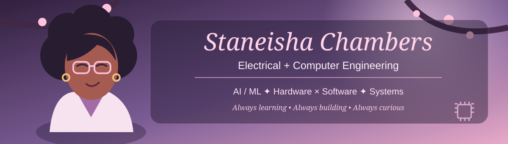

### 🌸 Electrical + Computer Engineering | AI/ML | Hardware × Software

*Curious about how things work. Even more curious about what we can build.*

---

## 🌷 A Little About Me

I'm pursuing dual degrees in **Electrical Engineering and Computer Engineering** at the **University of Michigan-Dearborn**.

My curiosity has taken me through automotive manufacturing, electrical transmission, robotics, aerospace, cloud computing, and AI semiconductor technology. What fascinates me most is the intersection of **hardware, software, and artificial intelligence**, particularly how we can use them to solve meaningful problems.

I'm especially interested in AI/ML, machine learning infrastructure, GPU computing, and the systems that make intelligent technology possible.

Outside of engineering, you'll probably find me watching anime, playing basketball, or looking for something spicy to eat! 🌶️

## 💼 My Engineering Journey

| Organization | Experience |
|---|---|
| **Amazon Web Services, Annapurna Labs** | AI semiconductor characterization and yield analysis |
| **GE Aerospace** | Cloud computing and data analytics |
| **General Motors, Advanced Robotics Center** | Autonomous robotics, virtual reality, and engineering tools |
| **ITC Holdings** | Electrical transmission systems |
| **General Motors, Vehicle Systems** | Automotive engineering and manufacturing |

Each experience has introduced me to a different side of engineering, challenged what I thought I knew, and given me another reason to keep learning.

## 💻 Featured Projects

### 👁️ [Eye-Gaze Assistive Device](https://github.com/EECEschambers/Senior-Design---Eye-Gazer-Project)

Developing an assistive technology prototype that explores eye-gaze-controlled device interaction for individuals with disabilities.

`Embedded Systems` `Accessibility` `Hardware/Software Integration`

### 🧠 Swytch | AI Job Risk Indices

A Break Through Tech AI challenge investigating how different AI job-risk indices compare and where their assessments agree or disagree.

`AI/ML` `Data Analysis` `Research`

### 🐍 AI Accelerator Silicon Characterization | AWS Annapurna Labs

Developed an interactive Python, Streamlit, and Plotly dashboard for statistical process control across **77 million test measurements and 40+ circuit blocks** on an AI accelerator.

Built SQL/Python pipelines connecting wafer-sort and final-test measurements across more than **38,000 matched units**.

`Python` `SQL` `AWS` `Streamlit` `Plotly` `Statistical Analysis`

## 🛠️ My Technical Toolkit

**Programming & Data:** Python · C · C++ · SQL · MATLAB

**Tools & Platforms:** Git · GitHub · Linux · WSL2 · AWS · Streamlit · Plotly · ROS 2

**Engineering Interests:** AI/ML · Embedded Systems · Computer Architecture · Operating Systems · GPU Computing · Semiconductor Validation

## 🌱 Currently Learning

- GPU and parallel computing
- Data structures and algorithms with C++
- Operating systems and computer architecture
- Machine learning and AI infrastructure
- Linux, Docker, Kubernetes, and cloud deployment

*My goal is to understand not just how to use technology, but how and why it works.*

## 📊 GitHub Activity

## 🐟 My GitHub Koi

*Growing one contribution at a time.*

## 🌸 Beyond Engineering

⚔️ **Favorite anime:** Demon Slayer

🏀 **Favorite sport:** Basketball

🌶️ **Favorite food:** Anything spicy!

💗 **Something I believe:** Curiosity can take you places you never imagined.

---

### Thanks for stopping by! 🌷

*Always learning. Always building. Always curious.*

